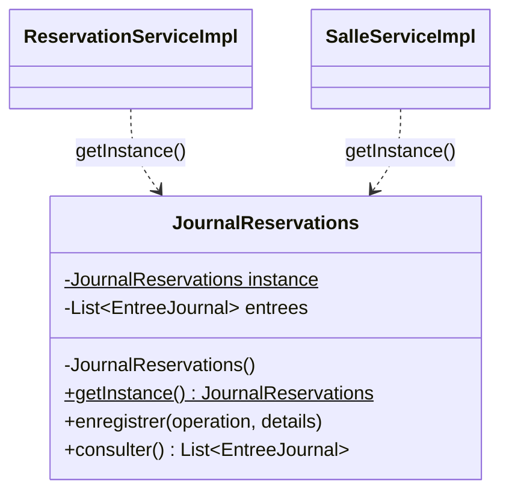
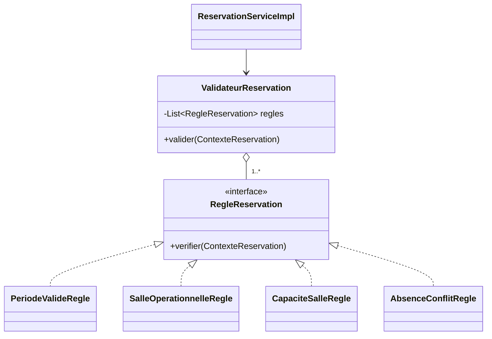
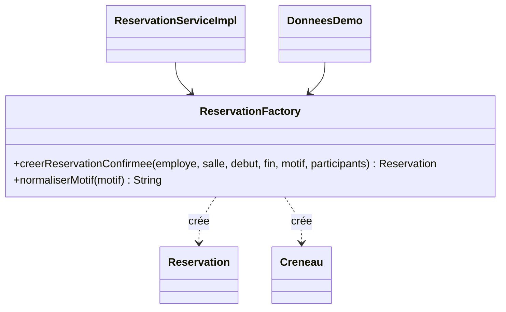

# Dossier de conception — Gestionnaire de réservation de salles (Projet 4)

Module : *Conception Agile des Solutions d'Entreprise* — Modélisation avancée des SI (MASI).

Ce document justifie les choix techniques du projet et montre comment le code respecte
les **principes SOLID** et les **design patterns Singleton, Strategy et Factory** étudiés en cours.

---

## 1. Architecture en couches

```
tn.salles.reservation
├── model/            Entités JPA + objets valeur (Salle, Reservation, Creneau, Periode...)
├── repository/       Accès aux données (interfaces Spring Data JPA)
├── service/          Interfaces des services métier (abstractions)
│   ├── commande/     Données d'entrée des cas d'utilisation (ReservationCommande, SalleCommande)
│   └── impl/         Implémentations des services
├── designpatterns/
│   ├── singleton/    JournalReservations
│   ├── strategy/     RegleReservation, ValidateurReservation, regles/*
│   └── factory/      ReservationFactory
├── exception/        RegleMetierException, RessourceIntrouvableException
├── web/              Contrôleurs Thymeleaf (pages de gestion)
│   ├── form/         Objets de formulaire
│   └── api/          API REST + dto/ + gestion des erreurs
└── config/           Données de démonstration (profil dev)
```

Sens des dépendances : **web → service (interfaces) → repository (interfaces) → model**.
Aucune couche basse ne dépend d'une couche haute (le service ne connaît plus les formulaires web).

---

## 2. Justification des technologies utilisées

| Technologie | Rôle dans le projet | Pourquoi ce choix |
|---|---|---|
| **Java 21 (LTS)** | Langage | Version à support long terme ; `record` (DTO, commandes, `Periode`), `switch` moderne, streams. Langage orienté objet adapté à l'application de SOLID et des design patterns vus en cours (exemples du cours en Java). |
| **Spring Boot 3.3** | Socle applicatif | Configuration automatique, serveur Tomcat intégré, démarrage par `mvn spring-boot:run`. Son **injection de dépendances** est la mise en œuvre directe du principe DIP : les classes reçoivent des abstractions par leur constructeur. |
| **Spring Web MVC** | Contrôleurs HTML et API REST `/api/v1` | Un seul framework pour les pages serveur et l'API JSON consommée par le site Salleo. |
| **Spring Data JPA / Hibernate** | Persistance | Les repositories sont de simples interfaces ; les requêtes JPQL (détection de chevauchement) restent lisibles. Verrou pessimiste (`@Lock`) pour empêcher deux réservations simultanées de la même salle, et `@Version` (verrou optimiste) sur `Reservation`. |
| **Bean Validation (Jakarta Validation)** | Validation des saisies | Annotations déclaratives (`@NotNull`, `@Min`, `@Size`...) sur les formulaires ; les erreurs de saisie sont rejetées avant d'atteindre la logique métier. |
| **H2 (en mémoire)** | Base de développement et de tests | Aucune installation requise ; base recréée à chaque lancement, idéale pour la démonstration et les tests automatisés. Mode `MySQL` activé pour rester compatible. |
| **MySQL** (profil `mysql`) | Base de production | SGBD relationnel répandu et gratuit ; le modèle (salles, créneaux, réservations) est fortement relationnel et a besoin de transactions et de contraintes d'unicité. Identifiants passés par variables d'environnement (`DB_URL`, `DB_USER`, `DB_PASSWORD`). |
| **Thymeleaf** | Pages de gestion (salles, employés, statistiques...) | Moteur de templates intégré à Spring, HTML valide, pas d'étape de build côté front. |
| **HTML / CSS / JavaScript (sans framework)** | Site Salleo (`static/site`) | Interface responsive légère, sans dépendance npm ni compilation : le site fonctionne directement depuis Spring Boot ou en statique. |
| **springdoc-openapi (Swagger UI)** | Documentation de l'API | Documentation interactive générée automatiquement sur `/swagger-ui.html` : utile pour tester l'API et pour l'équipe front. |
| **JUnit 5 + Spring Boot Test + MockMvc** | Tests | Tests unitaires des design patterns (sans base de données) et tests d'intégration des règles métier et de l'API. |
| **Maven** | Build et dépendances | Standard de l'écosystème Spring ; le `pom.xml` hérite de `spring-boot-starter-parent` qui fixe des versions compatibles. |
| **Git / GitHub** | Gestion de versions | Travail en équipe, historique des itérations (démarche Agile), branches pour les évolutions (ex. `refactor/solid-design-patterns`). |

---

## 3. Clean code : ce qui a été amélioré

| Avant | Après |
|---|---|
| Plusieurs instructions par ligne, noms courts (`f`, `r`, `ym`, `d`) | Une instruction par ligne, indentation standard, noms explicites (`commande`, `reservation`, `moisAffiche`) |
| Imports inutilisés / génériques (`import java.util.*`, `LockModeType` dans tous les repositories) | Imports explicites et utiles uniquement |
| Validation de période copiée dans 3 services | Objet valeur `Periode` (une seule implémentation) |
| Règles de réservation dans une grande méthode `verifierSalleEtConflits` | Une classe par règle (pattern Strategy) |
| Contrôleurs accédant directement aux repositories (`HomeController`, `EmployeController`, `ResponsableController`, `ReservationController`, `SalleController`) | Les contrôleurs passent toujours par un service |
| `HomeController` calculait des statistiques puis faisait une redirection (code mort) | Redirection simple |
| Le service dépendait de `web.form.ReservationForm` (couche basse → couche haute) | Le service reçoit une `ReservationCommande` ; le formulaire se convertit avec `versCommande()` |
| DTO et conversion définis dans `ApiController` | `web/api/dto/SalleDto` et `ReservationDto` avec `depuis(...)` |
| Setters publics sur `statut`, `creneau`, `employe` de `Reservation` | État encapsulé : `confirmer()`, `annuler()`, `modifierDetails()`, `Creneau.deplacer()` |
| `catch (Exception e)` générique dans le calendrier | `catch (DateTimeParseException e)` ciblé |
| Exceptions métier dans le package `service` | Package dédié `exception` |
| Nombres et chaînes répétés | Constantes nommées (`VUE_FORMULAIRE`, `FORMAT_DATE_HEURE`, `TAUX_MAXIMUM`) |

Le comportement fonctionnel et le format JSON de l'API sont **inchangés** : le site Salleo fonctionne sans modification.

---

## 4. Respect des principes SOLID

### S — Single Responsibility Principle

Chaque classe n'a qu'une seule raison de changer :

- **Contrôleurs** (`web/*Controller`) : uniquement HTTP (lire la requête, choisir la vue).
- **Services** (`service/impl/*ServiceImpl`) : orchestration d'un cas d'utilisation.
- **Règles** (`designpatterns/strategy/regles/*`) : une règle métier chacune (période, salle opérationnelle, capacité, conflit).
- `ReservationFactory` : construction des réservations uniquement.
- `JournalReservations` : traçabilité uniquement.
- `SalleDto` / `ReservationDto` : représentation JSON uniquement.
- `ApiErrorHandler` : traduction des exceptions en réponses HTTP uniquement.

> Exemple : si le message d'erreur de capacité change, seule `CapaciteSalleRegle` est modifiée.

### O — Open/Closed Principle

Le système de validation est **ouvert à l'extension et fermé à la modification**.
Pour ajouter une règle (ex. « pas de réservation le dimanche »), on crée une classe :

```java
@Component
@Order(5)
public class PasLeDimancheRegle implements RegleReservation {
    @Override
    public void verifier(ContexteReservation contexte) {
        if (contexte.commande().dateDebut().getDayOfWeek() == DayOfWeek.SUNDAY) {
            throw new RegleMetierException("Pas de réservation le dimanche.");
        }
    }
}
```

`ValidateurReservation` et `ReservationServiceImpl` **ne sont pas modifiés** : Spring injecte la nouvelle règle automatiquement.
Ce cas est vérifié par le test `contexteAppliqueToutesLesStrategiesEtAccepteUneNouvelleRegleSansModification`.

### L — Liskov Substitution Principle

- Toutes les implémentations de `RegleReservation` sont interchangeables : elles respectent le même contrat (ne rien faire si la règle est respectée, lever `RegleMetierException` sinon). Aucune ne lève `UnsupportedOperationException`.
- `RessourceIntrouvableException` étend `RegleMetierException` sans changer son sens : partout où une `RegleMetierException` est attendue (contrôleurs), elle peut être utilisée.
- Chaque `*ServiceImpl` peut remplacer son interface sans changer le comportement attendu par les contrôleurs.

### I — Interface Segregation Principle

- `RegleReservation` ne contient qu'**une seule méthode** : aucune règle n'est forcée d'implémenter une méthode inutile.
- Un service par besoin (`CalendrierService`, `DisponibiliteService`, `StatistiqueService`...) au lieu d'un « gros » service unique : `CalendrierController` ne dépend que de `CalendrierService`, il ne voit pas les méthodes de création ou d'annulation.
- Un repository par entité.

### D — Dependency Inversion Principle

Les classes de haut niveau dépendent d'**abstractions**, injectées par constructeur :

- Contrôleurs → interfaces `ReservationService`, `SalleService`, `EmployeService`... (et non les `*Impl`).
- Services → interfaces `ReservationRepository`, `SalleRepository`... (Spring Data fournit l'implémentation).
- `ValidateurReservation` → `List<RegleReservation>` (et non les règles concrètes).

> Comme dans l'exemple du cours (`Switch` → `Switchable`), on peut remplacer une implémentation sans toucher au code qui l'utilise.

---

## 5. Design patterns appliqués

### 5.1 Singleton — `designpatterns/singleton/JournalReservations`

**Problème.** Toutes les opérations (création, modification, annulation de réservation, création/modification de salle) doivent être tracées **au même endroit et dans l'ordre**. Plusieurs instances du journal donneraient des historiques incomplets et incohérents.

**Solution (conforme au cours MASI-03).**

- attribut `private static JournalReservations instance` ;
- **constructeur privé** ;
- méthode `public static synchronized getInstance()` : `synchronized` gère la **concurrence**, car un serveur web traite plusieurs requêtes en parallèle (cas des deux threads vu en cours) ;
- `consulter()` renvoie une copie (le journal ne peut pas être modifié de l'extérieur).

**Utilisation.** `ReservationServiceImpl` et `SalleServiceImpl` appellent `JournalReservations.getInstance().enregistrer(...)`.
Le journal est consultable sur `GET /api/v1/journal`.



> Remarque : les beans Spring (`@Service`, `@Component`) sont déjà uniques par défaut (portée *singleton* du conteneur). Le journal est volontairement implémenté avec le Singleton « classique » du cours, indépendant de Spring, pour illustrer le pattern.

### 5.2 Strategy — `designpatterns/strategy/`

**Problème.** Avant une réservation, plusieurs vérifications sont nécessaires (période, état de la salle, capacité, conflits). Les écrire dans une seule méthode avec des `if` crée une classe difficile à faire évoluer, et chaque nouvelle règle oblige à la modifier (violation d'OCP).

**Solution (conforme au cours MASI-06).**

| Rôle du pattern | Classe du projet |
|---|---|
| Strategy (interface) | `RegleReservation` |
| Stratégies concrètes | `PeriodeValideRegle`, `SalleOperationnelleRegle`, `CapaciteSalleRegle`, `AbsenceConflitRegle` |
| Context | `ValidateurReservation` |
| Client | `ReservationServiceImpl` |

Le contexte exécute les stratégies sans connaître leurs classes concrètes ; l'ordre est fixé par `@Order`.



### 5.3 Factory — `designpatterns/factory/ReservationFactory`

**Problème.** Créer une réservation demande plusieurs étapes : créer le `Creneau`, créer la `Reservation`, nettoyer le motif, la confirmer. Si ce code (`new Creneau(...)`, `new Reservation(...)`, `confirmer()`) est répété dans le service et dans les données de démonstration, le client est **fortement couplé** aux classes concrètes et toute évolution doit être reportée partout.

**Solution (conforme au cours MASI-08).** La création est **centralisée** dans `ReservationFactory.creerReservationConfirmee(...)`. Le client ne fait plus `new` : il demande l'objet à la fabrique.

**Utilisation.** `ReservationServiceImpl.creer(...)` et `DonneesDemo`.



Avantages (cours) : faible couplage, création centralisée, SRP (la création est séparée du code métier).

---

## 6. Tests

| Classe de test | Ce qui est vérifié |
|---|---|
| `DesignPatternsTest` (sans Spring) | Singleton (même instance, y compris avec 2 threads), journal, chaque stratégie, ajout d'une règle sans modifier le contexte (OCP), Factory |
| `ReservationServiceTest` | Création confirmée, refus des chevauchements, créneaux contigus acceptés, annulation, capacité, dates invalides, modification, statistiques |
| `ApiControllerTest` | Codes HTTP de l'API (200, 404, 400) et endpoint du journal |

Lancement : `mvn test`.

---

## 7. Limites connues

- La page de connexion du site est une maquette côté navigateur : pas d'authentification serveur (Spring Security à ajouter avant toute mise en production).
- Le journal est conservé en mémoire : il est vidé au redémarrage (suffisant pour la démonstration ; une table en base serait l'étape suivante).
